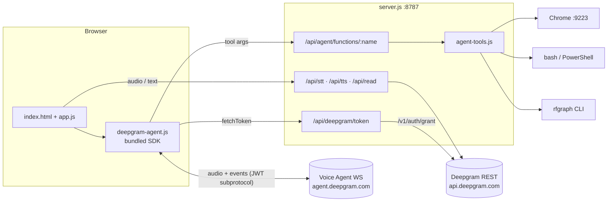
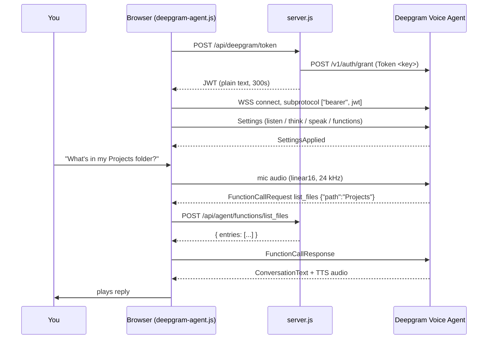

## The pieces

| File | Runs in | Job |
|---|---|---|
| `server.js` | Node | Express proxy. Holds the key, forwards STT / TTS / Read, mints agent tokens, dispatches agent tools. |
| `env.js` | Node | Resolves `DEEPGRAM_*` from env, shell rc files, or the Windows registry. |
| `agent-tools.js` | Node | Browser (Playwright over CDP), `rfgraph` graph CLI, and the shell tool. |
| `public/deepgram-agent.js` | Browser | Runtime adapter: settings builder, plugin registry, token fetch, SDK session. Bundled to `deepgram-agent.bundle.js`. |
| `public/app.js` + `index.html` | Browser | The three-tab dashboard UI. |

## A voice turn, end to end

<Note>
Tool calls run **client-side**: Deepgram asks the browser, the browser asks your local server. Deepgram's servers never reach `localhost`. See [Function calling](/concepts/function-calling) for why that matters.
</Note>

## Why a proxy at all

- **The key never ships to the browser.** The agent gets a 5-minute JWT; STT, TTS and Read go through server routes.
- **Browsers can't set WebSocket headers.** The token rides the `Sec-WebSocket-Protocol` header instead: `["bearer", jwt]` for grant tokens, `["token", key]` for raw keys.
- **Tools need a local process.** Reading files, driving Chrome and running commands can't happen from a web page.
